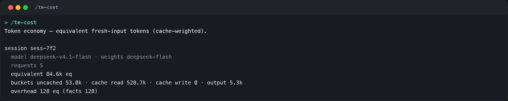

# dsh-tokeneconomizer

三个 DeepSeek Harness 组件，让 agent 干同样的活少花 token。它们是原生的 Cordis
插件，不是把脚本搬过来套一层：各自挂在 harness 自己的类型化事件上，没有 shell
包装、没有子进程、没有 JSON 兜底那一套，也不会去改别的工具的配置文件。

机制出自 [microsoft/TokenEconomizer](https://github.com/microsoft/TokenEconomizer)
（`arXiv:2610.22732`，Apache-2.0），它把这三套机制做成了进程外的工具，面向
Claude Code、Codex 和 Copilot CLI。出处记录在 `NOTICE` 里；本仓库是针对一套它
当年没有的插件 API 的独立 TypeScript 实现。



## 安装

从 npm：

```sh
dsh plugin --profile <profile> add dsh-te          # 三个一起
dsh plugin --profile <profile> add dsh-te-cost     # 或者只装一个
```

装上只是把包放好，**并不会激活**。包只有在 profile 里被列为 bundle 层时才生效，
所以要把它加进 `~/.dsh/profiles/<profile>/package.json` 的 `dsh.profile.bundles`，
放在最后，让它插在随包发布的层之后：

```json
"dsh": {
  "profile": {
    "bundles": ["@deepseek-ai/dsh-base", "@deepseek-ai/dsh-headless", "dsh-te"]
  }
}
```

然后确认三行都出现了：

```sh
dsh --profile <profile> --dump-config | grep "== dsh-te"
```

把某一行 `config` 里的 `enabled` 设成 `false`，组件就会保持安装但休眠；`dsh-te-prune`
默认就是这么发的。

从源码 checkout 安装要先构建一次：`link:` 安装只链接源码和它自己的
`node_modules`，不会替你跑构建，而包的入口指向 `lib/`。

```sh
pnpm install
pnpm build          # tsc -b -> packages/*/lib
dsh plugin --profile <profile> add link:<repo>/packages/bundle   # 或 .../cost
```

维护者发版：一条命令，机器上不留任何 npm token。

```sh
pnpm release:dry    # 只做检查：工作区干净、tag 未被占用、verify 通过，打印计划
pnpm release minor  # 五个包一起 bump、提交、打 tag、推送；CI 负责发布
```

tag 就是发布。`.github/workflows/publish.yml` 会重跑 `pnpm verify`，拒绝与
`package.json` 不一致的 tag，按拓扑顺序通过 OIDC Trusted Publishing 发布五个包，
并创建 GitHub Release。机器上不需要留任何凭据：丢了 token 也发不出去，已存在的
版本会失败而不是被覆盖。CI 不可用时用 `pnpm publish:local` 兜底，那条路需要
`~/.npmrc` 里的 token。

## 三个组件

整包还会注册 `/te`：一条命令报出三个组件是否在运行、各自测到了什么，以及要关掉某个组件该动哪一行。

### `dsh-te-cost` — 缓存加权记账

原始 token 总数会骗人，因为大部分输入 token 其实是缓存读，按全新输入 token 的
零头计费。这个组件把 harness 自己的四个互不重叠的用量桶（`uncachedInput`、
`cacheRead`、`cacheWrite`、`output`）按 provider 的真实价格比例折成一个**无量纲**
的数字：等效全新输入 token。

- 只监听 `session/event`（`request/header`、`assistant/message`），绝不碰 prompt
  或工具面。
- 保留一份会话视图和一份按仓库的账本，写在
  `$DSH_HOME/dsh-tokeneconomizer/repos/<key>/cost.json`。
- **把组件自己的开销也记进同一本账**：`recordOverhead(session, label, tokens)`
  让注入的文本照价计费，所以不可能靠把成本搬进插件来伪造“节省”。
- 每会话留一条滚动历史（最近 400 条：日期、等效 token、四个桶、组件开销、权重
  来源、是否是子代理），配合仓库累计值，让“随时间的变化”可以测量而不是靠回忆。
  同一个会话重复结算会更新那一条，不会重复计数。
- `/te-cost [session|repo]` 打印明细；`repo` 还会报出已记录的历史条数。
- `/te-cost trend` 按天打一行（带条形图）、给出每会话的等效 token 中位数（子代理
  会话不进中位数），并说明 400 条上限丢掉了多少条最老的。
  `/te-cost repos` 列出账本里所有仓库，按花费从高到低。state 目录是按 base64 key
  命名的，不列出来根本没法问某仓库的趋势。

未知模型回落到默认权重表，记为 `weightsSource: 'default'` 而不是报错：插件绝不能
因为一张价格表就弄坏一次会话。

### `dsh-te-facts` — 按仓库学习事实，并会退役

监听 shell 调用；会话结束时，“这里失败的写法”加“同一个意图下后来成功的另一种
写法”就是一条事实（`env_value` 修复是第二个族）。事实按仓库隔离（优先 git origin
remote，否则用工作目录）。

一条事实不是被观测到就会展示：要**三个不同会话**确认后才提升，而且只有当它要
避免的浪费仍在至少 40% 的会话里继续发生（至少 4 个会话的样本）时才会被注入。等
模型不再犯这个错，它就不再注入；之后有会话推翻它，它就退役。

- 走已记录的 pre-step 通道：**每个 turn 的第一步**注入一条 user 角色的消息，没有
  合格事实时什么都不做，上限 4 条 / 600 字符。每个 turn 都重复是有意的：线路
  级压缩器（billion-context 只保留最近几条消息）会把早先那一份折出请求，turn
  边界是它一定能活下来的位置。代价是每个 turn 往会话日志追加一份约百 token 的
  通知，所以这个块必须保持这么小。
- 存的是修复本身：同一个意图下失败和成功的命令形式，以及环境变量的**名字**。
  从不存文件内容，从不存输出文本。
- 把注入花了多少、阻止了什么记在同一本账上：每条事实记录它被注入进哪些会话、
  花了多少 token、哪些会话触发了它、它本该阻止的失败产生了多少浪费。没有这三个
  数字，“注入到底回不回本”只能靠猜。
- `/te-facts` 列出已知事实，带状态、score、命中率，以及 `inj N/Xeq`（注入进 N 个
  会话、共 X 等效 token）和 `after w/t`（首次注入之后仍发生的浪费）。
- `/te-facts stats` 回答另一个问题：按状态计数、注入总共花了多少，以及逐条事实的
  盈亏平衡点（注入的等效 token ÷ 每次失败的等效 token，也就是它的文本要阻止几次
  复发才回本），旁边是这条事实实际有的观测数。它只报绝对计数，并明说账本里
  没有基线错误率，所以不宣称任何“提升百分比”。

移植过来的常量：`K_PROMOTE=3`、`GAMMA=0.8`、`LAMBDA=5.0`、`FIRE_GATE=0.40`、
`FIRE_MIN_N=4`。

### `dsh-te-prune` — 不再发送没人调用的工具

每个工具定义都跟着每一个请求走。这个组件按仓库统计一个工具有多少个会话没被用过；
超过 `idleSessions`（默认 5）之后，用工具注册表自带的会话级限制把它藏起来，会话
结束时再放开。

- 默认关闭，而且是刻意的：工具集合属于请求前缀的一部分，藏工具会改变 provider
  能复用的内容。决定只在会话开始时做一次并保持整个会话，这样会话内部的前缀是稳的。
- 测量始终开启。关着的 prune 照样记录计数（工具名和使用次数，没有别的内容），因为
  这些数字是判断「开了值不值」的唯一依据；`enabled` 决定的是要不要真的藏。
- `/te-prune dry-run` 列出下一个会话会藏哪些工具，并估算能省多少 token。估算按字符
  数除以 4，输出里会说明这一点，也会提一次性代价：工具集合变化后的第一个请求要按
  全价重读前缀。
- 永不隐藏 harness 的基本能力（shell、编辑、读文件、子代理、任务……），
  `maxHidden` 把每次会话的损失上限定在 8 个工具。
- 也永不隐藏外部压缩器的工具（`compress`、`decompress`、`search_context`，以及
  billion-context 注册的那一套 `acp_*`，含把降采样图片取回原图的
  `acp_read_original_image`）；藏掉它们，模型就会去找一个不存在的工具。
- `/te-prune` 显示闲置计数；`/te-prune restore` 把工具还回来，并记为永不隐藏。

## 配置

每个组件只有一小份 `Config`，写在 profile 的 patch 行里：

```yaml
- id: te-facts
  name: 'dsh-te-facts'
  config:
    enabled: true
    maxFacts: 4
    maxChars: 600
```

| 组件 | 设置 | 默认 | 含义 |
|---|---|---|---|
| cost | `enabled`、`persist` | `true`、`true` | 折叠用量、写仓库账本 |
| facts | `enabled` | `true` | 观察、学习、注入 |
| facts | `maxFacts`、`maxChars` | `4`、`600` | 注入预算 |
| prune | `enabled` | `false` | 隐藏需要手动开启 |
| prune | `idleSessions`、`maxHidden` | `5`、`8` | 何时隐藏、最多藏几个 |
| prune | `protected` | `[]` | 额外永不隐藏的名字 |

状态放在 `$DSH_HOME/dsh-tokeneconomizer/`（默认 `~/.dsh/`），按仓库 key 分区。写入是
原子的（`tmp` + `rename`），读取从不抛错。

## 跑几个会话之后怎么读账本

两个文件会慢慢长起来，都是纯 JSON：

- `repos/<key>/cost.json` — `history[]` 每条对应一个会话：日期、`equivalent`、
  四个桶、组件开销、权重来源。
- `repos/<key>/facts.json` — 每条事实的 `injectedTasks`/`injectedTokens`（注入块
  花了多少）、`exercisedTasks`（错误可能复发的会话）、`wastedTasks`/`wasteTokens`
  （实际复发了多少次、多贵）。

不想开文件的话，`/te-cost repo`、`/te-cost trend`、`/te-cost repos` 和
`/te-facts`、`/te-facts stats` 报的是同一批数字。会话结束时才落盘，所以当前会话的
那一条要等它关掉才出现。

## 验证

```sh
pnpm build             # tsc -b，四个源码包
pnpm typecheck         # tsc -p tsconfig.test.json，含所有测试
pnpm test              # vitest：160 个单测
pnpm test:integration  # vitest：11 个集成测试，跑真实 DSH 包
pnpm verify            # 以上四步，按顺序
```

三个层次，从便宜到有说服力：

**单测**在裸 Cordis `Context` 里挂组件、桩掉服务：cost 喂合成的会话事件；facts 和
prune 用四到六个模拟会话驱动，验证提升、命中闸门、两次推翻、闲置计数，以及限制
确实被放开。

**集成测试**（`test/integration/`）是更有说服力的那层：它们加载真正的
`@deepseek-ai/dsh-agent-loop`、`dsh-llm`、`dsh-tools`、`dsh-session`、
`dsh-tool-executor-native`，用脚本化的 `LlmAdapter` 顶替 provider，跑一个真实的
agent turn：无网络、无凭据、无模型。断言的就是组件声称的事：

- **cost** — 假 adapter 报的四个桶原样落进 `cost.json`，折叠成
  `equivalent: 211.25`；同一仓库两个会话累加、各自一条历史，之后从新会话执行
  `/te-cost repo` 能通过真实命令服务报出来。
- **facts** — 合格的事实在**模型请求**里就是一条 `dsh-te-facts` 消息（不只是落在
  状态文件里），命中闸门不满足时消失；真实的一次 `python -m pytest` 失败加之后的
  `pytest` 成功能端到端教会它；而且**第二个 turn 的请求里仍然带着这条通知**，这
  是“压缩器把旧副本折掉也能活下来”的回归测试。
- **prune** — 闲置工具在请求的 `toolNames` 里消失而注册表仍然认识它（是隐藏，不是
  注销）；不到阈值的工具照常在；`write` 永不被隐藏；压缩器的 `acp_*` 工具即使闲置
  很久也不会被隐藏。

这些测试抓到过一个真实的组合要求：DSH 0.2.2 在没有挂载 tool executor 时会拒绝
运行 agent，纯事件级的测试永远发现不了。

**真机手动验证**：用随包发布的 `headless` 模板建一个临时 profile、装上 bundle，
回答一个单词任务并干净退出：

```
$ dsh --profile te-headless "Reply with exactly: ok"
ok
```

那次运行产生了 `cost.json`，`equivalent: 9189`。答案是三个 token，花钱的是固定的
prompt 和工具定义。同一仓库第二个会话之后读到：

```json
{"equivalent": 9471.76, "buckets": {"uncachedInput": 9266, "cacheRead": 9088,
 "cacheWrite": 0, "output": 6}, "sessions": 2}
```

18,360 个原始 token 对 9,472 个等效 token：这个差距就是账本要折桶、而不是把
`totalTokens` 相加的全部理由。只装 `dsh-te-cost` 的 profile 也能正常启动，说明组件
确实是独立的。

没有任何测试能证明“在真实工作里跨很多会话的省钱效果”，那需要把插件留在真实工作
里跑，见 [docs/MEASUREMENT.md](docs/MEASUREMENT.md)。

## 刻意没有移植的

- **循环护栏 / 打断螺旋。** TokenEconomizer 自己的文档说它只在构造出来的循环上验证过，
  从没在真实螺旋上验证，而 DSH 已经自带 `dsh-repeat-tool-reminder`。移植一个未经验证、
  还得花模型调用才能打断 turn 的启发式，在这里不是好交易。
- **上下文压缩、花费面板。** `dsh-compaction*` 和 `@linxin666/dsh-usage` 已经覆盖；
  重复做只会增加冲突面。
- **LLM 提案器和另外四个事实族**（`boundary`、`arg_repair`、`absent_tool`、
  `empty_probe`）。TokenEconomizer 额外的模型调用就在它们身上；机械化的两族是便宜的
  那 80%。
- **Python sidecar。** 目标 harness 是 TypeScript 且同进程；再加一个运行时只会白白多出
  一个进程边界。

## 证据状态

TokenEconomizer 的头条数字（SWE-Bench 便宜 18–31%、Web-Bench 16–21%）只以常量的
形式存在于那个仓库的 `docs/assets/results_overview.py` 里，对应论文 Table 1；仓库
没有附带运行结果，文件里也这么写。它们是“值得一试”的理由，不是“这个移植继承了
这些数字”的证据。这里能验证的东西很窄，并且已经写在上面：算术是精确的、生命周期
闸门按规格工作、组件除了开头那一段有界的事实块之外不会改变 agent 的对话记录。

## 目录结构

```
packages/core/    纯逻辑：价格权重、桶折叠、事实生命周期、shell 记录抽取、
                  仓库身份、原子存储。不依赖 Cordis，单独做单测。
packages/cost/    账本服务 + /te-cost
packages/facts/   事实观察 + pre-step 注入 + /te-facts
packages/prune/   闲置计数 + 会话级工具限制 + /te-prune
packages/bundle/  一键安装的 patch
test/integration/ 真实组合的 harness（真 DSH 包，脚本化模型）
docs/PLAN.md      路线图、优先级与测量协议
```

## 引用与许可

本仓库实现的机制来自这篇论文，用了就请引用：

```bibtex
@misc{li2026tokeneconomizer,
  title         = {{TokenEconomizer}: Experience-Driven Black-Box Cost Control for Coding Agents},
  author        = {Li, Aaron J. and Xu, Weijia and Singh, Chandan and Chen, Zixiao and
                   Inala, Jeevana Priya and Siska, Charlotte and Tamersoy, Acar and Yu, Bin and
                   Stoica, Ion and Galley, Michel and Gao, Jianfeng},
  year          = {2026},
  eprint        = {2610.22732},
  archivePrefix = {arXiv},
  primaryClass  = {cs.CL},
  url           = {https://arxiv.org/abs/2610.22732}
}
```

本项目以 Apache License 2.0 授权，见 [`LICENSE`](LICENSE)。它是对
[microsoft/TokenEconomizer](https://github.com/microsoft/TokenEconomizer)
（Apache-2.0，Copyright (c) Microsoft Corporation and contributors）中若干机制的独立
实现；没有逐字复制任何源文件。[`NOTICE`](NOTICE) 记录了署名与哪些部分属于衍生。
